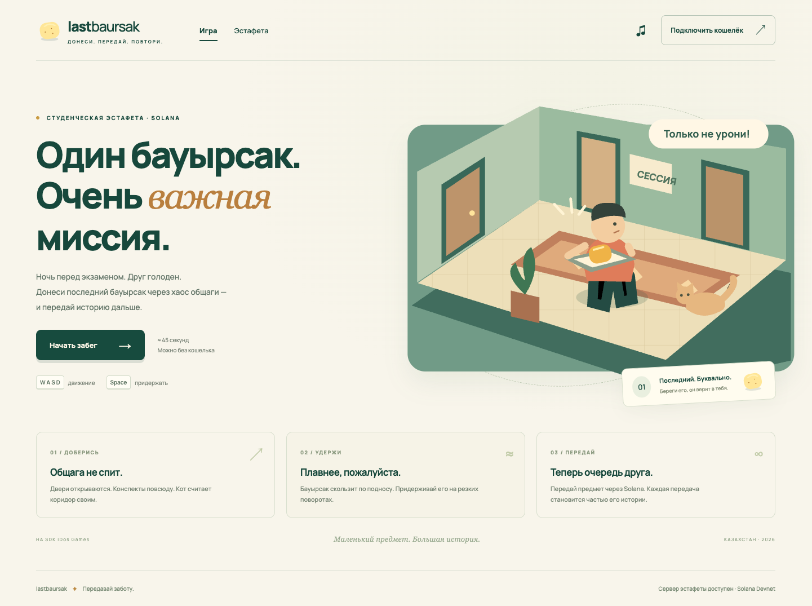

# Last Baursak

**Carry the last baursak through a chaotic student dorm. Pass it to a friend. Keep its story alive on Solana.**

**Live iDos Games build:** https://4nkmxdoj.idos.games/  
**Public game page:** https://idosgames.com/app/4NKMXDOJ/

Last Baursak is a short student game about getting the last baursak to a hungry friend on the night before an exam. The published iDos Games edition is a 45-second room-to-room challenge: dodge the cat, keep the tray balanced, and reach room 201. An optional Solana wallet signature identifies the player without a transaction or fee. This repository also contains a more detailed local gameplay and Devnet relay prototype; its extra mechanics are not yet part of the published game.



To review the hackathon build, use the **live iDos Games link above**. The source adapted for the platform editor is in [docs/idos-live.tsx](docs/idos-live.tsx). The screenshot and instructions below refer to the more detailed **local prototype**. In the live build, use **WASD / arrows** or on-screen controls to move, and **Space / Придержать** to lower tray wobble.

## Play locally

Requires Node.js 20.19+ or 22.12+.

```sh
npm ci
npm start
```

Open **http://127.0.0.1:5187/**. The relay API runs on port 8787. Practice requires no wallet and no iDos Games account.

- **WASD / arrow keys:** move toward room 201 at the top of the dorm.
- **Space:** steady the tray. This slows you down and uses stamina.
- **Phone:** drag the joystick and hold the “Придержать” button.
- Reach the friend before the timer expires, keeping the baursak on the tray.
- Pause stops simulation; a failed run restarts immediately.

The current interface is Russian. A typical successful run takes approximately 30–45 seconds. Browser testing completed runs in approximately 32–34 seconds.

## Solana integration

The published iDos Games build can **connect an injected Solana wallet and request a unique login-message signature** before displaying its public address as the player's identity. Signing a message does not require a transaction, token launch, or payment. The signature is handled in the browser; the published build does not persist a session server-side or store achievements on-chain.

The repository also contains the following **Devnet relay prototype**, which is kept here as the next milestone rather than being represented as already deployed:

The relay collectible is a real **SPL mint on Solana Devnet** with zero decimals and exactly one unit. The mint authority is revoked in the same transaction that creates the item. It is a unique token collectible, not a Metaplex NFT with marketplace metadata.

1. Connect Phantom or Solflare using an injected browser wallet.
2. Sign a one-time login challenge. The API verifies the Ed25519 signature.
3. Start and complete a run. The browser records quantized inputs; the server deterministically replays the exact simulation at 60 Hz and checks elapsed wall-clock time.
4. The server prepares a collectible issuance transaction only after a verified win. The wallet pays the Devnet account rent and transaction fee.
5. After a verified run, the owner can pass the one-unit token to a friend's Solana wallet.
6. A Memo instruction records the mint / handoff, run ID, recipient and completion time atomically with the token operation. The UI provides Solana Explorer links.

The server co-signs issuance; the player's wallet signs the final transaction. The API submits only the exact message it prepared for that authenticated player, and explicitly verifies the Devnet genesis hash. It does not hold player private keys.

**Trust boundary:** the server attests the run; Solana enforces token supply and ownership. There is no custom on-chain program enforcing gameplay. Token holders can transfer outside this game's UI, and those external transfers are not represented as verified game handoffs. Replay verification rejects fabricated outcomes and invalid inputs; it does not prevent automation or solve the replay in a human-proof way.

### Devnet setup

Create `.env` from `.env.example`. Fund the wallet with **test SOL** through [Solana Faucet](https://faucet.solana.com/). This prototype deliberately uses Devnet only.

The server creates its own signing key in `.server-data/issuer.json` with restricted file permissions. This directory is ignored by Git. Retain it on persistent storage when hosting the API: changing the issuer changes which collectible origins are accepted. Active sessions and verified runs are held in memory, expire after a bounded period, and are lost if the API restarts.

## iDos Games

The project was scaffolded from the official **@idosgames/mcp 0.1.27** host registry, with its pinned SDK packages. The game is a registered iDos Games module with a route, panel and `ctx.exposeToAgent` surface. The platform host and sign-in flow are retained in `src/platform.tsx` and `src/base/`.

**Current status:** the title is live in iDos Games as **Last Baursak** (`4NKMXDOJ-DEV` during development). The deployed build is a compact, self-contained arcade version with optional wallet signature. The local relay API remains a separate Devnet prototype and needs hosting before the relay collectible flow can go live.

`src/idos.title.ts` is retained as the original local scaffold identity file. The platform editor owns the canonical published source and title binding. See [platform setup](docs/IDOS_SETUP.md) and the [AI Coder brief](docs/AI_CODER_BRIEF.md).

The game is static browser code; the relay API is a separate Node service. To publish the static client to iDos Games, host this API over HTTPS, configure its `ALLOWED_ORIGINS`, and set `VITE_RELAY_API_URL` during the client build. The API cannot be deployed by uploading Vite's static `dist/` folder.

## Project structure

```text
src/base/                         Official iDos Games host UI
src/platform.tsx                  Official client + host entry
src/idos.title.ts                  Platform-generated Title identity
src/modules/last-baursak/
  game/simulation.ts              Shared deterministic gameplay
  game/render.ts                  Original Canvas 2D rendering
  game/agent.ts                   iDos Games observation / input surface
  components/                    React UI, keyboard and touch controls
server/index.ts                  Authentication, verified runs and API
server/chain.ts                  Solana issuance, transfers and history
scripts/verify-idos.ts            Real DEV Title login check
scripts/                        Submission packaging and local checks
tests/                          Simulation and transaction tests
```

## Validation

```sh
npm test
npm run build
npm run verify
```

`npm run verify` targets the local scaffold and intentionally fails with `title_not_bound` until a real platform identity is supplied. It is not a test of the already-published platform build.

See [validation status](docs/VALIDATION.md) for the exact checks and the remaining gaps. In particular, a confirmed Devnet mint and handoff still need to be demonstrated using funded test wallets. Transaction construction and signatures have been verified against the live Devnet RPC, but a complete on-chain round trip is not yet verified.

## Submission material

- [Pitch and short description](docs/SUBMISSION.md)
- [Local gameplay video](demo/local-gameplay.webm) — a real practice run; on-chain relay demo is still pending
- [Demo video storyboard](docs/DEMO_SCRIPT.md)
- [iDos Games setup](docs/IDOS_SETUP.md)
- [Screenshots](docs/screenshots/)

Before submission, record a demo of the **published** iDos game, confirm the Colosseum project and video links, and keep the relay limitations above visible until the Devnet flow is independently verified.
